# Technika cyfrowa – zadania 3 i 4

Ćwiczenie: *Analiza i projektowanie układów logicznych z wykorzystaniem algebry Boole'a*.

Oznaczenia: $\overline{A}$ – negacja, $\cdot$ – AND (iloczyn, często pomijany: $AB = A\cdot B$), $+$ – OR, $\oplus$ – XOR. W Simulinku etykiety bloków zapisują negację jako `¬`, np. `¬A·B` $=\overline{A}\cdot B$.

## Pliki

| Plik | Zawartość |
|---|---|
| `Bramki_zad1_4.slx` | model Simulink (format **R2025a**): zadania 1–2 z `DoZrobienia3i4.slx` oraz dobudowane zadania 3 i 4 |
| `schematy/zad3a.png` … `schematy/zad4f.png` | schemat każdego podpunktu do sprawozdania |
| `schematy/model_caly.png` | cały model |
| `wyniki_symulacji.md` | tabele prawdy odczytane z symulacji |
| `zadania_def.m` | opis wszystkich układów (bramki i połączenia) |
| `buduj_zad3_zad4.m` | skrypt, który dobudował zadania 3 i 4 do modelu |
| `weryfikuj_zad3_zad4.m` | skrypt kontrolny: 16 symulacji i sprawdzenie bramek XOR |

## Jak działa model

- Pod zadaniami 1–2 są wspólne wejścia **A, B, C, D**. Każde składa się z bloków Toggle Switch → Constant → Goto. Przełącznik ma pozycje opisane jednoznacznie jako 0 i 1. Podsystemy pobierają wejścia blokami From `[A]`…`[D]`, więc oba porównywane układy korzystają z tych samych sygnałów.
- Każdy podpunkt to osobny podsystem `Zad3a` … `Zad4f`. Po dwukliku widać w nim:
  - w zad. 3: układ pierwotny (wyjście **F**) i uproszczony (wyjście **F_upr**),
  - w zad. 4: układ zbudowany z dozwolonych bramek (wyjście **Y**) i osobno bramkę wzorcową (wyjście **Y_wz**),
  - bramkę **XOR**, która porównuje oba wyjścia.
- Display obok podsystemu pokazuje trzy liczby: `[F; F_upr; XOR]` albo `[Y; Y_wz; XOR]`. **XOR = 0 oznacza, że oba układy dają ten sam wynik.**
- Ręczne sprawdzenie: Run (Stop Time = inf, jak w zadaniach 1–2), przestawiać przełączniki A–D i odczytywać Display.
- Automatyczne sprawdzenie: w MATLAB-ie w tym folderze wpisać `weryfikuj_zad3_zad4`. Skrypt uruchamia 16 symulacji (wszystkie kombinacje A, B, C, D), sprawdza XOR i zapisuje tabele do `wyniki_symulacji.md`.

**Wynik weryfikacji w Simulinku: wszystkie 13 podpunktów (3a–3g, 4a–4f) zgodne: XOR = 0 dla każdej z 16 kombinacji A, B, C, D. Szczegóły w `wyniki_symulacji.md`.**

---

## Zadanie 3 – uproszczenie wyrażeń i weryfikacja

**Sposób weryfikacji (wszystkie podpunkty):** układ pierwotny i uproszczony są zasilane z tych samych wejść, a ich wyjścia trafiają na bramkę XOR. Model był symulowany dla wszystkich 16 kombinacji A, B, C, D. Jeżeli XOR = 0 w każdym wierszu, funkcje są równoważne. Pojedynczy przypadek testowy by tu nie wystarczył.

| | Wyrażenie | Najprostsza postać | Bramki: pierwotny → uproszczony |
|---|---|---|---|
| a | $\overline{A}B + A\overline{B} + AB$ | $A + B$ | 6 → 1 (OR) |
| b | $\overline{A}\,\overline{B}C + \overline{A}BC + A\overline{B}C + ABC$ | $C$ | 7 → 0 (przewód) |
| c | $(A+\overline{B})(\overline{A}+B)(A+B)$ | $AB$ | 6 → 1 (AND) |
| d | $ABC\cdot\overline{A\overline{B}C}\cdot(A+B+C)$ | $ABC$ | 5 → 1 (AND, 3 wejścia) |
| e | $\overline{A}B\overline{C}D + \overline{A}BCD + AB\overline{C}D + ABCD$ | $BD$ | 7 → 1 (AND) |
| f | $\overline{(A+B)(\overline{B}+A)}$ | $\overline{A}$ | 4 → 1 (NOT) |
| g | $(A\oplus B) + AB$ | $A + B$ | 3 → 1 (OR) |

### 3a) $F = \overline{A}\cdot B + A\cdot\overline{B} + A\cdot B$

$$
\begin{aligned}
F &= \overline{A}B + A\overline{B} + AB + AB && \text{idempotentność: } AB = AB + AB\\
  &= (\overline{A}B + AB) + (A\overline{B} + AB) && \text{przemienność, łączność}\\
  &= B(\overline{A} + A) + A(\overline{B} + B) && \text{rozdzielność}\\
  &= B\cdot 1 + A\cdot 1 && \text{dopełnienie}\\
  &= A + B && \text{element neutralny, przemienność}
\end{aligned}
$$

**Najprostsza postać: $F = A + B$** (bramka OR). Funkcja jest równa 0 tylko dla A = B = 0.

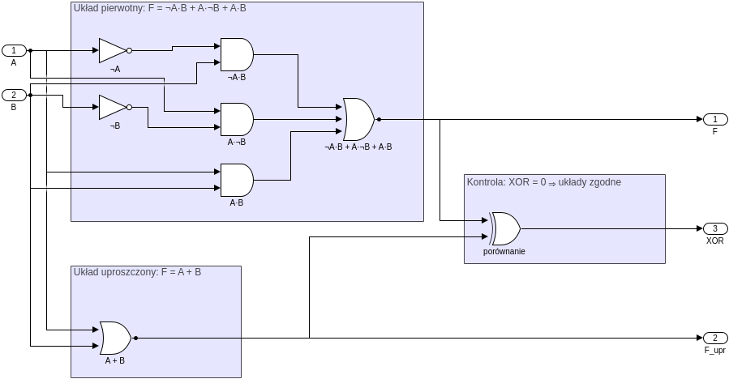

Tabela prawdy (kolumny pośrednie policzone ze wzorów, wyjścia zgodne z symulacją):

| $A$ | $B$ | $\overline{A}B$ | $A\overline{B}$ | $AB$ | **F** | **F_upr = A+B** | XOR |
|---|---|---|---|---|---|---|---|
| 0 | 0 | 0 | 0 | 0 | 0 | 0 | 0 |
| 0 | 1 | 1 | 0 | 0 | 1 | 1 | 0 |
| 1 | 0 | 0 | 1 | 0 | 1 | 1 | 0 |
| 1 | 1 | 0 | 0 | 1 | 1 | 1 | 0 |

### 3b) $F = \overline{A}\cdot\overline{B}\cdot C + \overline{A}\cdot B\cdot C + A\cdot\overline{B}\cdot C + A\cdot B\cdot C$

$$
\begin{aligned}
F &= C\,(\overline{A}\,\overline{B} + \overline{A}B + A\overline{B} + AB) && \text{rozdzielność (wyłączenie } C\text{)}\\
  &= C\,\big(\overline{A}(\overline{B} + B) + A(\overline{B} + B)\big) && \text{rozdzielność}\\
  &= C\,(\overline{A}\cdot 1 + A\cdot 1) = C\,(\overline{A} + A) && \text{dopełnienie, element neutralny}\\
  &= C\cdot 1 = C && \text{dopełnienie, element neutralny}
\end{aligned}
$$

**Najprostsza postać: $F = C$.** Wynik nie zależy od A i B: cztery iloczyny obejmują wszystkie kombinacje A, B przy C = 1. W uproszczonym układzie nie ma żadnej bramki, a wyjście jest połączone z wejściem C.

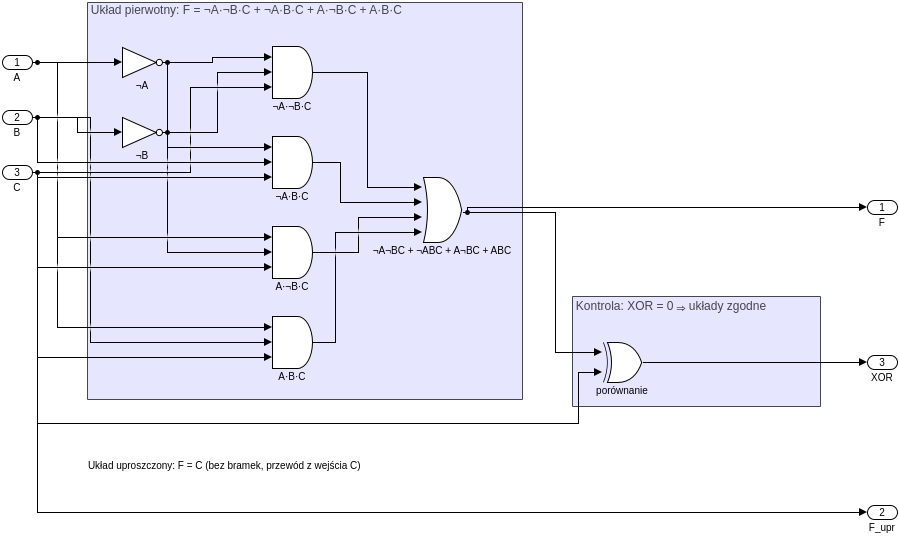

Tabela prawdy (kolumny pośrednie policzone ze wzorów, wyjścia zgodne z symulacją):

| $A$ | $B$ | $C$ | $\overline{A}\,\overline{B}C$ | $\overline{A}BC$ | $A\overline{B}C$ | $ABC$ | **F** | **F_upr = C** | XOR |
|---|---|---|---|---|---|---|---|---|---|
| 0 | 0 | 0 | 0 | 0 | 0 | 0 | 0 | 0 | 0 |
| 0 | 0 | 1 | 1 | 0 | 0 | 0 | 1 | 1 | 0 |
| 0 | 1 | 0 | 0 | 0 | 0 | 0 | 0 | 0 | 0 |
| 0 | 1 | 1 | 0 | 1 | 0 | 0 | 1 | 1 | 0 |
| 1 | 0 | 0 | 0 | 0 | 0 | 0 | 0 | 0 | 0 |
| 1 | 0 | 1 | 0 | 0 | 1 | 0 | 1 | 1 | 0 |
| 1 | 1 | 0 | 0 | 0 | 0 | 0 | 0 | 0 | 0 |
| 1 | 1 | 1 | 0 | 0 | 0 | 1 | 1 | 1 | 0 |

### 3c) $F = (A + \overline{B})\cdot(\overline{A} + B)\cdot(A + B)$

$$
\begin{aligned}
F &= (A + \overline{B})(A + B)\cdot(\overline{A} + B) && \text{przemienność}\\
  &= (A + \overline{B}B)\cdot(\overline{A} + B) && \text{rozdzielność: } (A+X)(A+Y) = A + XY\\
  &= (A + 0)\cdot(\overline{A} + B) = A\,(\overline{A} + B) && \text{dopełnienie, element neutralny}\\
  &= A\overline{A} + AB && \text{rozdzielność}\\
  &= 0 + AB = AB && \text{dopełnienie, element neutralny}
\end{aligned}
$$

**Najprostsza postać: $F = A\cdot B$** (bramka AND).

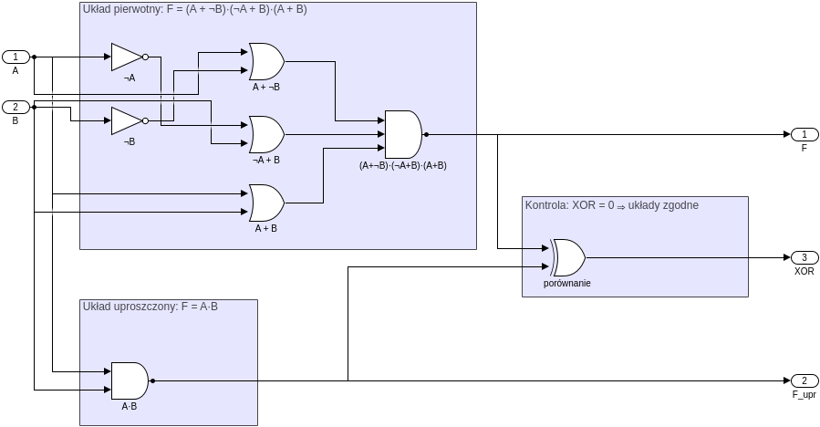

Tabela prawdy (kolumny pośrednie policzone ze wzorów, wyjścia zgodne z symulacją):

| $A$ | $B$ | $A+\overline{B}$ | $\overline{A}+B$ | $A+B$ | **F** | **F_upr = AB** | XOR |
|---|---|---|---|---|---|---|---|
| 0 | 0 | 1 | 1 | 0 | 0 | 0 | 0 |
| 0 | 1 | 0 | 1 | 1 | 0 | 0 | 0 |
| 1 | 0 | 1 | 0 | 1 | 0 | 0 | 0 |
| 1 | 1 | 1 | 1 | 1 | 1 | 1 | 0 |

### 3d) $F = A\cdot B\cdot C\cdot\overline{A\cdot\overline{B}\cdot C}\cdot(A + B + C)$

Najpierw negacja środkowego czynnika:

$$
\overline{A\overline{B}C} = \overline{A} + \overline{\overline{B}} + \overline{C} = \overline{A} + B + \overline{C} \qquad \text{prawo de Morgana, podwójna negacja}
$$

$$
\begin{aligned}
F &= ABC\,(\overline{A} + B + \overline{C})\,(A + B + C)\\
  &= (A\overline{A}BC + ABBC + ABC\overline{C})\,(A + B + C) && \text{rozdzielność}\\
  &= (0 + ABC + 0)\,(A + B + C) && \text{dopełnienie, idempotentność } (BB = B)\text{, element dominujący}\\
  &= BC\cdot A\,\big(A + (B + C)\big) && \text{przemienność, łączność}\\
  &= BC\cdot A = ABC && \text{pochłanianie: } A(A + X) = A
\end{aligned}
$$

**Najprostsza postać: $F = A\cdot B\cdot C$** (bramka AND z 3 wejściami). Sprawdzenie: $ABC = 1$ tylko dla A = B = C = 1. Wtedy $\overline{A\overline{B}C} = \overline{1\cdot 0\cdot 1} = 1$ oraz $A + B + C = 1$, więc pozostałe czynniki nic nie zmieniają.

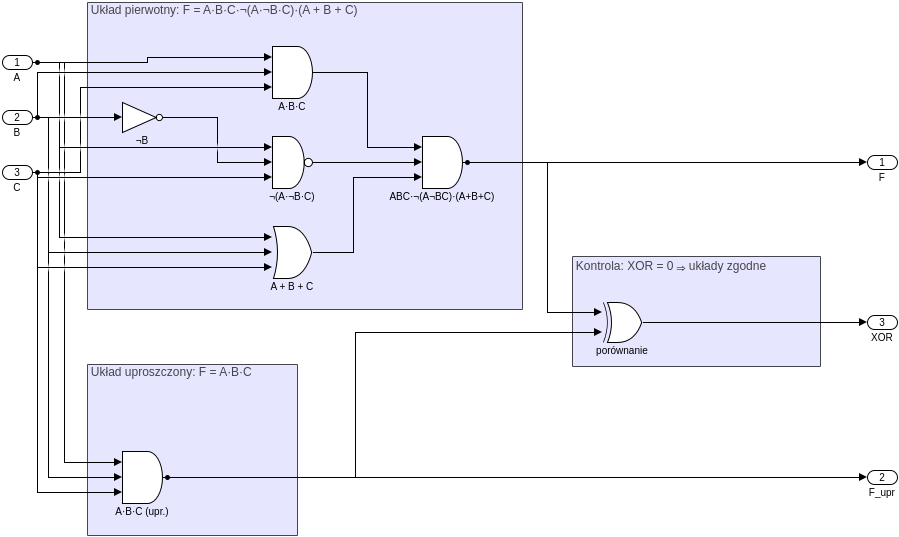

Tabela prawdy (kolumny pośrednie policzone ze wzorów, wyjścia zgodne z symulacją):

| $A$ | $B$ | $C$ | $ABC$ | $\overline{A\overline{B}C}$ | $A+B+C$ | **F** | **F_upr = ABC** | XOR |
|---|---|---|---|---|---|---|---|---|
| 0 | 0 | 0 | 0 | 1 | 0 | 0 | 0 | 0 |
| 0 | 0 | 1 | 0 | 1 | 1 | 0 | 0 | 0 |
| 0 | 1 | 0 | 0 | 1 | 1 | 0 | 0 | 0 |
| 0 | 1 | 1 | 0 | 1 | 1 | 0 | 0 | 0 |
| 1 | 0 | 0 | 0 | 1 | 1 | 0 | 0 | 0 |
| 1 | 0 | 1 | 0 | 0 | 1 | 0 | 0 | 0 |
| 1 | 1 | 0 | 0 | 1 | 1 | 0 | 0 | 0 |
| 1 | 1 | 1 | 1 | 1 | 1 | 1 | 1 | 0 |

### 3e) $F = \overline{A}\cdot B\cdot\overline{C}\cdot D + \overline{A}\cdot B\cdot C\cdot D + A\cdot B\cdot\overline{C}\cdot D + A\cdot B\cdot C\cdot D$

$$
\begin{aligned}
F &= BD\,(\overline{A}\,\overline{C} + \overline{A}C + A\overline{C} + AC) && \text{przemienność, rozdzielność (wyłączenie } BD\text{)}\\
  &= BD\,\big(\overline{A}(\overline{C} + C) + A(\overline{C} + C)\big) && \text{rozdzielność}\\
  &= BD\,(\overline{A} + A) && \text{dopełnienie, element neutralny}\\
  &= BD\cdot 1 = BD && \text{dopełnienie, element neutralny}
\end{aligned}
$$

**Najprostsza postać: $F = B\cdot D$.** Wejścia A i C nie mają wpływu na wynik. Ten sam schemat co w 3b, tylko z czterema zmiennymi. Tabela ma 16 wierszy; XOR = 0 we wszystkich.

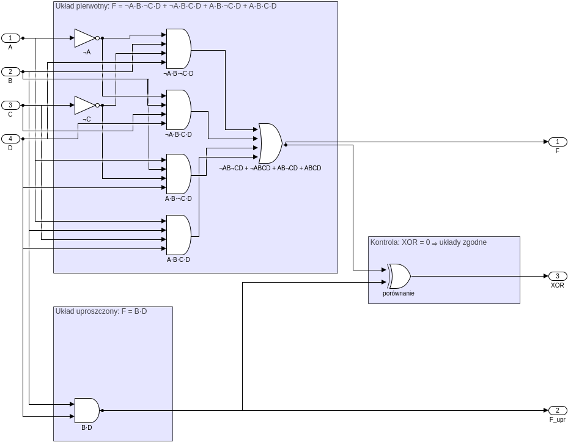

Tabela prawdy (kolumny pośrednie policzone ze wzorów, wyjścia zgodne z symulacją):

| $A$ | $B$ | $C$ | $D$ | $\overline{A}B\overline{C}D$ | $\overline{A}BCD$ | $AB\overline{C}D$ | $ABCD$ | **F** | **F_upr = BD** | XOR |
|---|---|---|---|---|---|---|---|---|---|---|
| 0 | 0 | 0 | 0 | 0 | 0 | 0 | 0 | 0 | 0 | 0 |
| 0 | 0 | 0 | 1 | 0 | 0 | 0 | 0 | 0 | 0 | 0 |
| 0 | 0 | 1 | 0 | 0 | 0 | 0 | 0 | 0 | 0 | 0 |
| 0 | 0 | 1 | 1 | 0 | 0 | 0 | 0 | 0 | 0 | 0 |
| 0 | 1 | 0 | 0 | 0 | 0 | 0 | 0 | 0 | 0 | 0 |
| 0 | 1 | 0 | 1 | 1 | 0 | 0 | 0 | 1 | 1 | 0 |
| 0 | 1 | 1 | 0 | 0 | 0 | 0 | 0 | 0 | 0 | 0 |
| 0 | 1 | 1 | 1 | 0 | 1 | 0 | 0 | 1 | 1 | 0 |
| 1 | 0 | 0 | 0 | 0 | 0 | 0 | 0 | 0 | 0 | 0 |
| 1 | 0 | 0 | 1 | 0 | 0 | 0 | 0 | 0 | 0 | 0 |
| 1 | 0 | 1 | 0 | 0 | 0 | 0 | 0 | 0 | 0 | 0 |
| 1 | 0 | 1 | 1 | 0 | 0 | 0 | 0 | 0 | 0 | 0 |
| 1 | 1 | 0 | 0 | 0 | 0 | 0 | 0 | 0 | 0 | 0 |
| 1 | 1 | 0 | 1 | 0 | 0 | 1 | 0 | 1 | 1 | 0 |
| 1 | 1 | 1 | 0 | 0 | 0 | 0 | 0 | 0 | 0 | 0 |
| 1 | 1 | 1 | 1 | 0 | 0 | 0 | 1 | 1 | 1 | 0 |

### 3f) $F = \overline{(A + B)\cdot(\overline{B} + A)}$

$$
\begin{aligned}
(A + B)(\overline{B} + A) &= (A + B)(A + \overline{B}) && \text{przemienność}\\
  &= A + B\overline{B} && \text{rozdzielność: } (A+X)(A+Y) = A + XY\\
  &= A + 0 = A && \text{dopełnienie, element neutralny}\\
F &= \overline{A}
\end{aligned}
$$

Ten sam wynik daje droga przez prawa de Morgana:
$F = \overline{A + B} + \overline{\overline{B} + A} = \overline{A}\,\overline{B} + B\overline{A} = \overline{A}(\overline{B} + B) = \overline{A}$.

**Najprostsza postać: $F = \overline{A}$** (bramka NOT). Wynik nie zależy od B.

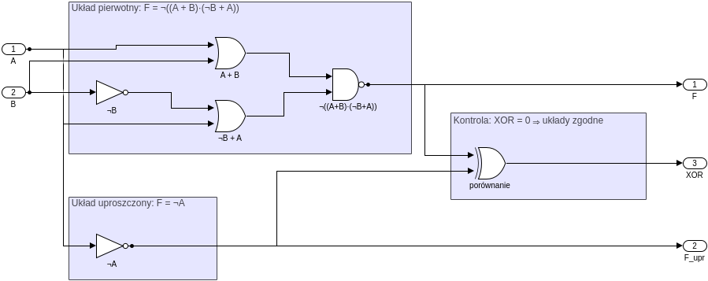

Tabela prawdy (kolumny pośrednie policzone ze wzorów, wyjścia zgodne z symulacją):

| $A$ | $B$ | $A+B$ | $\overline{B}+A$ | **F** | **F_upr = $\overline{A}$** | XOR |
|---|---|---|---|---|---|---|
| 0 | 0 | 0 | 1 | 1 | 1 | 0 |
| 0 | 1 | 1 | 0 | 1 | 1 | 0 |
| 1 | 0 | 1 | 1 | 0 | 0 | 0 |
| 1 | 1 | 1 | 1 | 0 | 0 | 0 |

### 3g) $F = (A \oplus B) + A\cdot B$

$$
\begin{aligned}
F &= \overline{A}B + A\overline{B} + AB && \text{postać XOR: } A\oplus B = \overline{A}B + A\overline{B}\\
  &= A + B && \text{dalej jak w 3a)}
\end{aligned}
$$

**Najprostsza postać: $F = A + B$.** XOR różni się od OR tylko w wierszu A = B = 1. Składnik $AB$ uzupełnia właśnie ten wiersz, dlatego suma daje OR.

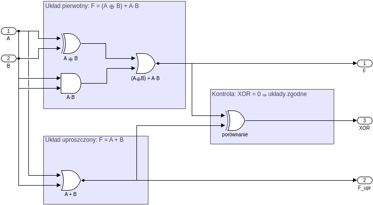

Tabela prawdy (kolumny pośrednie policzone ze wzorów, wyjścia zgodne z symulacją):

| $A$ | $B$ | $A\oplus B$ | $AB$ | **F** | **F_upr = A+B** | XOR |
|---|---|---|---|---|---|---|
| 0 | 0 | 0 | 0 | 0 | 0 | 0 |
| 0 | 1 | 1 | 0 | 1 | 1 | 0 |
| 1 | 0 | 1 | 0 | 1 | 1 | 0 |
| 1 | 1 | 0 | 1 | 1 | 1 | 0 |

---

## Zadanie 4 – budowa bramek z podanych elementów

W każdym podsystemie `Zad4x` układ jest zbudowany **wyłącznie** z dozwolonych bramek (górna ramka). Bramka docelowa stoi osobno, w ramce „Bramka wzorcowa”, i służy tylko do porównania wyników. Jej wyjście $Y_{wz}$ oraz wyjście $Y$ trafiają na bramkę XOR: wynik 0 oznacza zgodność z wzorcem.

| | Cel | Dozwolone | Wzór | Użyte bramki |
|---|---|---|---|---|
| a | OR | AND, NOT | $A + B = \overline{\overline{A}\cdot\overline{B}}$ | 3× NOT, 1× AND |
| b | AND | OR, NOT | $AB = \overline{\overline{A} + \overline{B}}$ | 3× NOT, 1× OR |
| c | NAND | NOT, AND | $\overline{AB}$ = NOT(AND) | 1× AND, 1× NOT |
| d | XOR | OR, AND, NOT | $A\oplus B = \overline{A}B + A\overline{B}$ | 2× NOT, 2× AND, 1× OR |
| e | AND | XOR, OR | $AB = (A + B)\oplus(A\oplus B)$ | 1× OR, 2× XOR |
| f | XOR | NAND | $A\oplus B = \mathrm{NAND}\big(\mathrm{NAND}(A,N_1),\ \mathrm{NAND}(B,N_1)\big),\ N_1 = \mathrm{NAND}(A,B)$ | 4× NAND |

### 4a) OR z bramek AND i NOT

1. Funkcja docelowa: $Y = A + B$.
2. Przekształcenie:
$$
A + B = \overline{\overline{A + B}} = \overline{\overline{A}\cdot\overline{B}} \qquad \text{podwójna negacja, prawo de Morgana}
$$
3. Realizacja: dwie bramki NOT negują wejścia, AND tworzy $\overline{A}\cdot\overline{B}$, a końcowa bramka NOT neguje wynik.

Tabela prawdy (kolumny pośrednie policzone ze wzorów, wyjścia zgodne z symulacją):

| $A$ | $B$ | $\overline{A}$ | $\overline{B}$ | $\overline{A}\cdot\overline{B}$ | **Y** $=\overline{\overline{A}\cdot\overline{B}}$ | OR (wzorzec) | XOR |
|---|---|---|---|---|---|---|---|
| 0 | 0 | 1 | 1 | 1 | 0 | 0 | 0 |
| 0 | 1 | 1 | 0 | 0 | 1 | 1 | 0 |
| 1 | 0 | 0 | 1 | 0 | 1 | 1 | 0 |
| 1 | 1 | 0 | 0 | 0 | 1 | 1 | 0 |

### 4b) AND z bramek OR i NOT

1. Funkcja docelowa: $Y = A\cdot B$.
2. Przekształcenie:
$$
A\cdot B = \overline{\overline{A\cdot B}} = \overline{\overline{A} + \overline{B}} \qquad \text{podwójna negacja, prawo de Morgana}
$$
3. Realizacja: NOT na obu wejściach, OR tworzy $\overline{A} + \overline{B}$, końcowa bramka NOT.

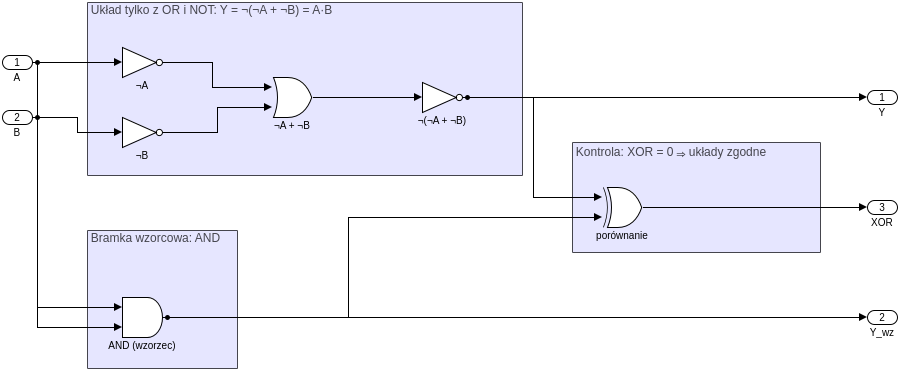

Tabela prawdy (kolumny pośrednie policzone ze wzorów, wyjścia zgodne z symulacją):

| $A$ | $B$ | $\overline{A}$ | $\overline{B}$ | $\overline{A}+\overline{B}$ | **Y** $=\overline{\overline{A}+\overline{B}}$ | AND (wzorzec) | XOR |
|---|---|---|---|---|---|---|---|
| 0 | 0 | 1 | 1 | 1 | 0 | 0 | 0 |
| 0 | 1 | 1 | 0 | 1 | 0 | 0 | 0 |
| 1 | 0 | 0 | 1 | 1 | 0 | 0 | 0 |
| 1 | 1 | 0 | 0 | 0 | 1 | 1 | 0 |

### 4c) NAND z bramek NOT i AND

1. Funkcja docelowa: $Y = \overline{A\cdot B}$.
2. NAND to z definicji zanegowany iloczyn, więc nie trzeba niczego przekształcać: $Y = \mathrm{NOT}\big(\mathrm{AND}(A, B)\big)$.
3. Realizacja: AND, a po nim NOT.

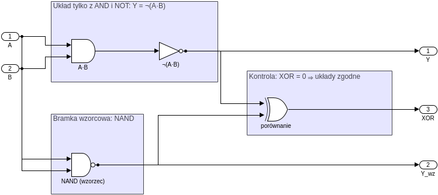

Tabela prawdy (kolumny pośrednie policzone ze wzorów, wyjścia zgodne z symulacją):

| $A$ | $B$ | $AB$ | **Y** $=\overline{AB}$ | NAND (wzorzec) | XOR |
|---|---|---|---|---|---|
| 0 | 0 | 0 | 1 | 1 | 0 |
| 0 | 1 | 0 | 1 | 1 | 0 |
| 1 | 0 | 0 | 1 | 1 | 0 |
| 1 | 1 | 1 | 0 | 0 | 0 |

### 4d) XOR z bramek OR, AND i NOT

1. Funkcja docelowa: $Y = A\oplus B$, czyli 1, gdy wejścia są różne.
2. Postać sumy iloczynów: XOR = 1 tylko w wierszach 01 i 10, stąd
$$
A\oplus B = \overline{A}\cdot B + A\cdot\overline{B}
$$
3. Realizacja: 2× NOT, 2× AND (iloczyny $\overline{A}B$ i $A\overline{B}$), 1× OR.

Tabela prawdy (kolumny pośrednie policzone ze wzorów, wyjścia zgodne z symulacją):

| $A$ | $B$ | $\overline{A}B$ | $A\overline{B}$ | **Y** $=\overline{A}B+A\overline{B}$ | XOR (wzorzec) | porównanie XOR |
|---|---|---|---|---|---|---|
| 0 | 0 | 0 | 0 | 0 | 0 | 0 |
| 0 | 1 | 1 | 0 | 1 | 1 | 0 |
| 1 | 0 | 0 | 1 | 1 | 1 | 0 |
| 1 | 1 | 0 | 0 | 0 | 0 | 0 |

### 4e) AND z bramek XOR i OR

1. Funkcja docelowa: $Y = A\cdot B$.
2. Przekształcenie. Z zadania 3g: $A + B = (A\oplus B) + AB$. Składniki $A\oplus B$ i $AB$ nigdy nie są jednocześnie równe 1 ($A\oplus B = 1$ dla 01 i 10, $AB = 1$ dla 11). Dla takich składników OR daje to samo co XOR, więc $A + B = (A\oplus B)\oplus AB$. Obie strony łączymy XOR-em z $(A\oplus B)$ i korzystamy z $X\oplus X = 0$ oraz $X\oplus 0 = X$:
$$
(A + B)\oplus(A\oplus B) = AB
$$
   Krócej: OR i XOR różnią się tylko w wierszu 11, więc ich XOR daje 1 tylko dla A = B = 1. To jest właśnie AND.
3. Realizacja: OR i XOR liczone równolegle z A i B, a na wyjściu druga bramka XOR.

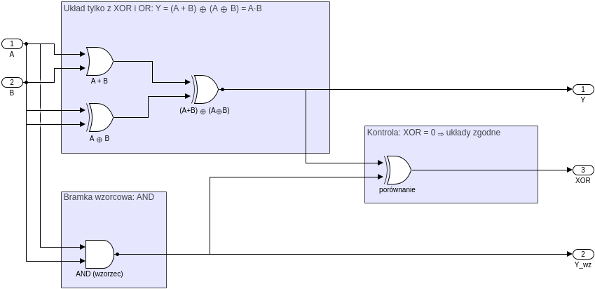

Tabela prawdy (kolumny pośrednie policzone ze wzorów, wyjścia zgodne z symulacją):

| $A$ | $B$ | $A+B$ | $A\oplus B$ | **Y** $=(A+B)\oplus(A\oplus B)$ | AND (wzorzec) | XOR |
|---|---|---|---|---|---|---|
| 0 | 0 | 0 | 0 | 0 | 0 | 0 |
| 0 | 1 | 1 | 1 | 0 | 0 | 0 |
| 1 | 0 | 1 | 1 | 0 | 0 | 0 |
| 1 | 1 | 1 | 0 | 1 | 1 | 0 |

### 4f) XOR wyłącznie z bramek NAND

1. Funkcja docelowa: $Y = A\oplus B$.
2. Układ czterech bramek NAND:
$$
N_1 = \overline{AB},\qquad N_2 = \overline{A\cdot N_1},\qquad N_3 = \overline{B\cdot N_1},\qquad Y = \overline{N_2\cdot N_3}
$$
   Wyprowadzenie:
$$
\begin{aligned}
Y &= \overline{N_2\cdot N_3} = \overline{N_2} + \overline{N_3} && \text{prawo de Morgana}\\
  &= A\cdot N_1 + B\cdot N_1 && \text{podwójna negacja}\\
  &= (A + B)\cdot\overline{AB} && \text{rozdzielność}\\
  &= (A + B)(\overline{A} + \overline{B}) && \text{prawo de Morgana}\\
  &= A\overline{A} + A\overline{B} + B\overline{A} + B\overline{B} && \text{rozdzielność}\\
  &= A\overline{B} + \overline{A}B = A\oplus B && \text{dopełnienie, element neutralny}
\end{aligned}
$$
3. Realizacja: 4× NAND, bez żadnych innych bramek. To jest dokładnie układ ze **schematu a) w zadaniu 2** ($Q_1 = N_1$, $Q_2 = N_2$, $Q_3 = N_3$, $Q = Y$). Dlatego tamten układ okazał się równoważny bramce XOR.

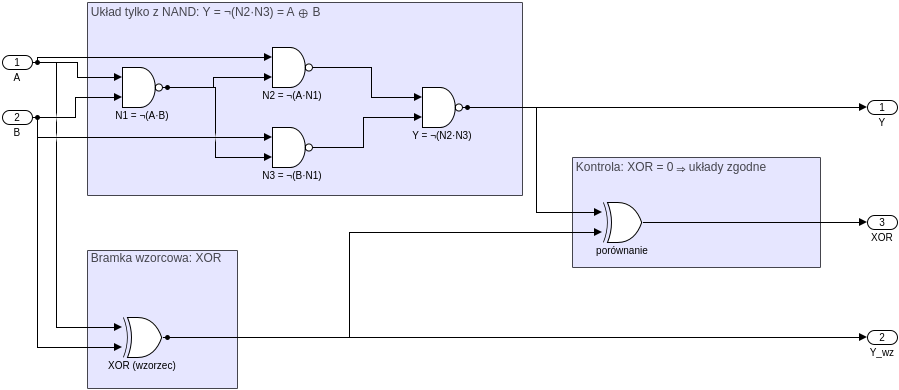

Tabela prawdy (kolumny pośrednie policzone ze wzorów, wyjścia zgodne z symulacją):

| $A$ | $B$ | $N_1$ | $N_2$ | $N_3$ | **Y** | XOR (wzorzec) | porównanie XOR |
|---|---|---|---|---|---|---|---|
| 0 | 0 | 1 | 1 | 1 | 0 | 0 | 0 |
| 0 | 1 | 1 | 1 | 0 | 1 | 1 | 0 |
| 1 | 0 | 1 | 0 | 1 | 1 | 1 | 0 |
| 1 | 1 | 0 | 1 | 1 | 0 | 0 | 0 |

---

## Wnioski (propozycje do sprawozdania)

- Prawa algebry Boole'a pozwalają znacznie zmniejszyć liczbę bramek bez zmiany działania układu: w zadaniu 3 z 3–7 bramek zostaje 1 bramka albo sam przewód (3b).
- Po uproszczeniu widać, od których wejść funkcja naprawdę zależy: w 3b tylko od C, w 3e tylko od B i D, w 3f tylko od A.
- Równoważność trzeba sprawdzić dla **wszystkich** $2^n$ kombinacji wejść. Bramka XOR porównująca wyjścia daje w Simulinku prosty test: musi zwracać 0 w każdym wierszu.
- Prawa de Morgana pozwalają zamieniać AND na OR (i odwrotnie) kosztem negacji, dlatego zestawy {AND, NOT} i {OR, NOT} są funkcjonalnie pełne (4a, 4b).
- NAND jest bramką uniwersalną: z samych NAND można zbudować XOR (4f), a wcześniej NOT, AND i OR (pkt 2.4 instrukcji).
- Wyniki symulacji w Simulinku zgadzają się z obliczeniami we wszystkich podpunktach; rozbieżności nie wystąpiły.
